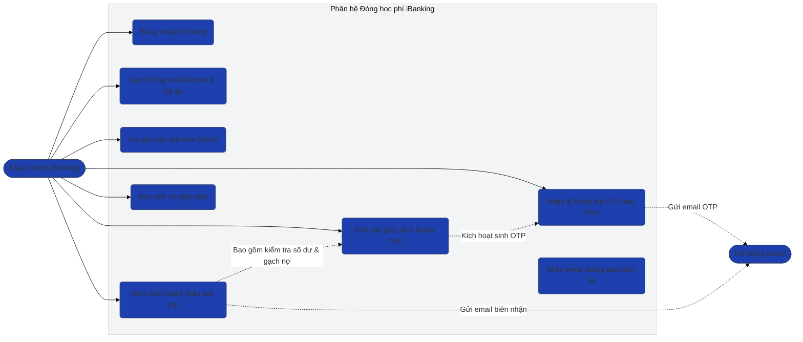
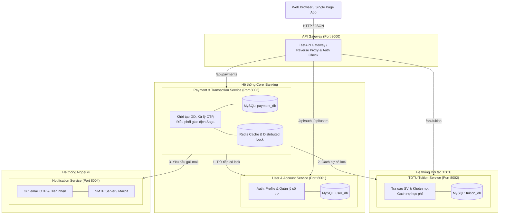
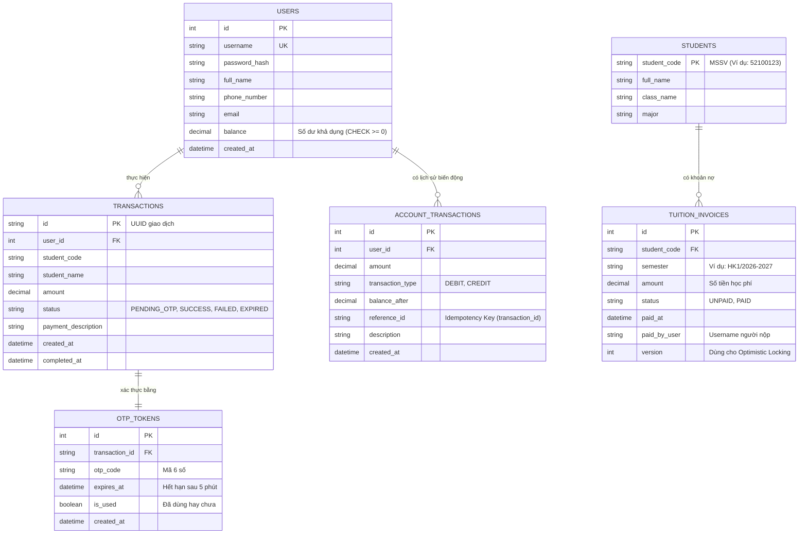

# DỰ ÁN GIỮA KỲ: PHÂN HỆ ĐÓNG HỌC PHÍ CỦA ỨNG DỤNG iBanking (CS504070 - SOA)
## THIẾT KẾ HỆ THỐNG VÀ ĐẶC TẢ KIẾN TRÚC MICROSERVICES

### 1. Giới thiệu tổng quan
Hệ thống mô phỏng phân hệ thanh toán học phí iBanking cho sinh viên Trường Đại học Tôn Đức Thắng (TDTU), áp dụng kiến trúc Microservices sử dụng:
- **Backend Framework:** Python (FastAPI)
- **Database:** MySQL 8.0 (InnoDB Engine, hỗ trợ ACID transactions & Row-level Locking)
- **Email Service:** SMTP (hỗ trợ Mailpit / Gmail SMTP)
- **Deployment:** Docker & Docker Compose
- **Frontend:** Single Page Application (HTML5 / Vanilla CSS / Modern JS)

---

### 2. Sơ đồ Use Case (Use Case Diagram)



---

### 3. Sơ đồ Kiến trúc Microservices (Microservices Architecture Diagram)



#### Trách nhiệm của từng Service:
1. **API Gateway (Port 8000):**
   - Định tuyến tập trung (Centralized Routing).
   - Xác thực JWT Token và chuyển tiếp context người dùng (`X-User-Id`, `X-User-Email`) đến các service nội bộ.
   - CORS handling cho Web Frontend.
2. **User & Account Service (Port 8001):**
   - Quản lý tài khoản đăng nhập (username, password hash với bcrypt).
   - Quản lý số dư tài khoản iBanking (`balance`).
   - Cung cấp API atomic trừ tiền có sử dụng **Pessimistic Lock (`SELECT ... FOR UPDATE`)** để đảm bảo số dư không bị âm trong tình huống nạp/rút/thanh toán đồng thời.
3. **Tuition Service (Port 8002 - Mô phỏng hệ thống Đào tạo TDTU):**
   - Quản lý thông tin sinh viên TDTU (MSSV, Họ tên, Khoa/Ngành).
   - Quản lý các hóa đơn/khoản thu học phí (`tuition_invoices`) gồm: Số tiền, Trạng thái (`UNPAID`, `PAID`), Học kỳ, Thời gian thanh toán.
   - Cung cấp API tra cứu nợ học phí theo MSSV và API gạch nợ với cơ chế kiểm tra trạng thái nguyên tử (**Optimistic / Pessimistic Lock**) chống gạch nợ trùng.
4. **Payment & Transaction Service (Port 8003):**
   - Quản lý toàn bộ vòng đời giao dịch thanh toán: `PENDING_OTP` $\to$ `SUCCESS` / `FAILED`.
   - Sinh mã OTP ngẫu nhiên 6 chữ số, thời hạn 5 phút, gắn liền với `transaction_id`, không trùng lặp, dùng đúng 1 lần.
   - Đóng vai trò **Saga Orchestrator** điều phối luồng thanh toán giữa User Service và Tuition Service.
   - Lưu trữ lịch sử giao dịch chi tiết phục vụ tra cứu.
5. **Notification Service (Port 8004):**
   - Nhận yêu cầu gửi email OTP xác thực giao dịch.
   - Nhận yêu cầu gửi email biên lai thanh toán thành công.
   - Hỗ trợ gửi qua SMTP (Mailpit chạy local tiện demo hoặc Gmail SMTP thực tế).

---

### 4. Sơ đồ Thực thể Quan hệ (ERD - Entity Relationship Diagram)



---

### 5. Thiết kế Xử lý Giao dịch & Concurrency (Data Consistency)

Theo yêu cầu mục 5 và Tiêu chí 6 của đề bài:

#### Tình huống 1: Nhiều giao dịch đồng thời trên cùng một tài khoản (Double Spending)
- **Vấn đề:** Người dùng có số dư 10,000,000 VNĐ. Người dùng mở 2 tab và nhấn xác nhận thanh toán 2 khoản học phí (mỗi khoản 6,000,000 VNĐ) tại cùng một thời điểm. Nếu không xử lý concurrency, cả 2 luồng đều đọc số dư là 10,000,000 VNĐ $\to$ hợp lệ $\to$ trừ tiền cả 2 $\to$ Số dư bị âm (-2,000,000 VNĐ).
- **Giải pháp kỹ thuật (Pessimistic Locking trong MySQL):**
  Khi User Service nhận request trừ tiền:
  ```sql
  START TRANSACTION;
  -- Khóa độc quyền dòng tài khoản này cho đến khi kết thúc transaction
  SELECT id, balance FROM users WHERE id = :user_id FOR UPDATE;
  
  -- Kiểm tra điều kiện ngay tại thời điểm đã có khóa
  IF balance >= :amount THEN
      UPDATE users SET balance = balance - :amount WHERE id = :user_id;
      COMMIT;
      -- Trả về thành công
  ELSE
      ROLLBACK;
      -- Báo lỗi: Số dư không đủ (INSUFFICIENT_BALANCE)
  END IF;
  ```
  Nhờ `FOR UPDATE`, request thứ hai đến sẽ phải đợi (hoặc lock timeout) cho đến khi request thứ nhất hoàn tất. Khi request thứ hai đọc lại số dư, số dư chỉ còn 4,000,000 VNĐ $\to$ từ chối ngay lập tức!

#### Tình huống 2: Nhiều người đồng thời thanh toán cho cùng một khoản học phí (MSSV)
- **Vấn đề:** Bố và mẹ cùng thanh toán học phí cho con (MSSV: `52100888`, số tiền 8,000,000 VNĐ) tại cùng 1 giây. Cả 2 đều nhập đúng OTP và ấn xác nhận. Nếu không kiểm soát, cả 2 tài khoản của bố và mẹ đều bị trừ tiền.
- **Giải pháp kỹ thuật (Atomic Condition Update & Row Lock trên Tuition Invoice):**
  Trong Tuition Service khi gạch nợ:
  ```sql
  START TRANSACTION;
  -- Khóa khoản nợ học phí này
  SELECT id, status FROM tuition_invoices 
  WHERE student_code = :mssv AND semester = :semester FOR UPDATE;

  IF status = 'UNPAID' THEN
      UPDATE tuition_invoices 
      SET status = 'PAID', paid_at = NOW(), paid_by_user = :username 
      WHERE id = :invoice_id;
      COMMIT;
      -- Thành công gạch nợ
  ELSE
      ROLLBACK;
      -- Báo lỗi: Khoản học phí đã được thanh toán bởi người khác (ALREADY_PAID)
  END IF;
  ```
  Kết hợp với cơ chế **Compensating Transaction (Saga Pattern)** trong Payment Service:
  - Nếu bước gạch nợ ở Tuition Service thất bại (do người khác đã thanh toán trước), Payment Service sẽ rollback/hoàn lại số tiền đã trừ vào tài khoản người nộp tiền (Compensate refund). Nhờ đó, người nộp sau không bị mất tiền và khoản học phí được đảm bảo chỉ gạch nợ đúng 1 lần duy nhất.

---

### 6. Thiết kế RESTful API chi tiết

#### API Gateway / User Service (`http://localhost:8000/api/users`)
- `POST /api/auth/login`: Đăng nhập, trả về JWT Token và thông tin user cơ bản.
  - Request: `{"username": "user1", "password": "password123"}`
  - Response 200: `{"access_token": "...", "token_type": "bearer", "user": {...}}`
- `GET /api/users/me`: Lấy thông tin cá nhân (Họ tên, SĐT, Email, Số dư khả dụng).
- `GET /api/users/me/history`: Xem lịch sử các giao dịch đã thực hiện.

#### Tuition Service (`http://localhost:8000/api/tuition`)
- `GET /api/tuition/students/{student_code}`: Tra cứu thông tin sinh viên và học phí cần đóng.
  - Response 200: 
    ```json
    {
      "student_code": "52100888",
      "full_name": "Nguyễn Văn An",
      "major": "Kỹ thuật phần mềm",
      "invoice": {
        "id": 1,
        "semester": "HK1/2026-2027",
        "amount": 12500000.00,
        "status": "UNPAID"
      }
    }
    ```
  - Response 404: Không tìm thấy sinh viên hoặc không có khoản nợ.

#### Payment Service (`http://localhost:8000/api/payments`)
- `POST /api/payments/initiate`: Khởi tạo giao dịch đóng học phí.
  - Request: `{"student_code": "52100888", "amount": 12500000.00}`
  - Logic: Kiểm tra số dư >= học phí, kiểm tra nợ còn UNPAID $\to$ Tạo giao dịch `PENDING_OTP` $\to$ Sinh OTP và gửi qua Email $\to$ Trả về `transaction_id`.
  - Response 201: `{"transaction_id": "uuid-...", "status": "PENDING_OTP", "expires_in_seconds": 300, "message": "OTP đã được gửi đến email của bạn"}`
- `POST /api/payments/confirm`: Xác nhận thanh toán bằng mã OTP.
  - Request: `{"transaction_id": "uuid-...", "otp_code": "123456"}`
  - Logic: Validate OTP (chưa dùng, < 5 phút) $\to$ Thực hiện trừ tiền & gạch nợ với khóa Concurrency $\to$ Cập nhật giao dịch `SUCCESS` $\to$ Gửi email biên lai.
  - Response 200: `{"status": "SUCCESS", "transaction_id": "uuid-...", "completed_at": "...", "receipt": {...}}`
  - Response 400/409: Lỗi nếu OTP sai, hết hạn, hoặc bị conflict concurrency.
- `GET /api/payments/transactions/{transaction_id}`: Xem chi tiết trạng thái giao dịch.
